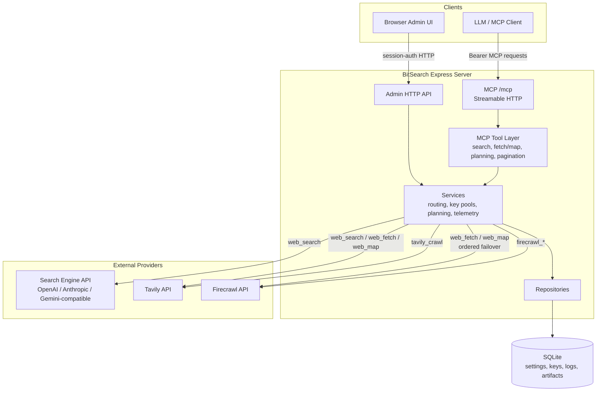
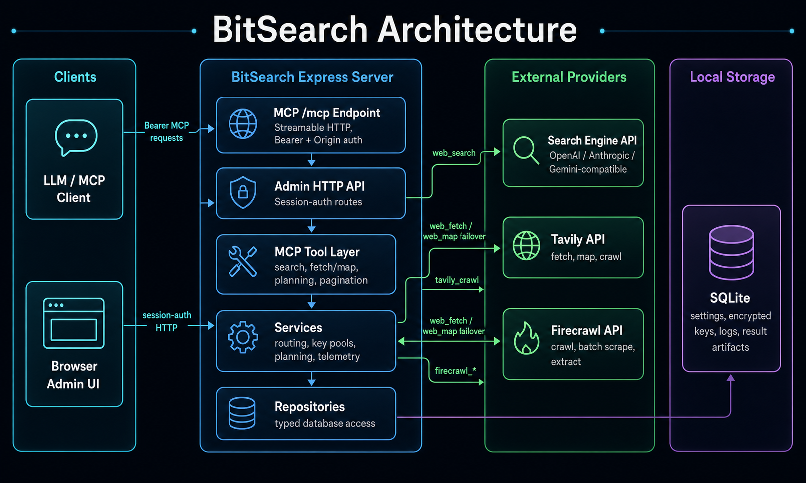
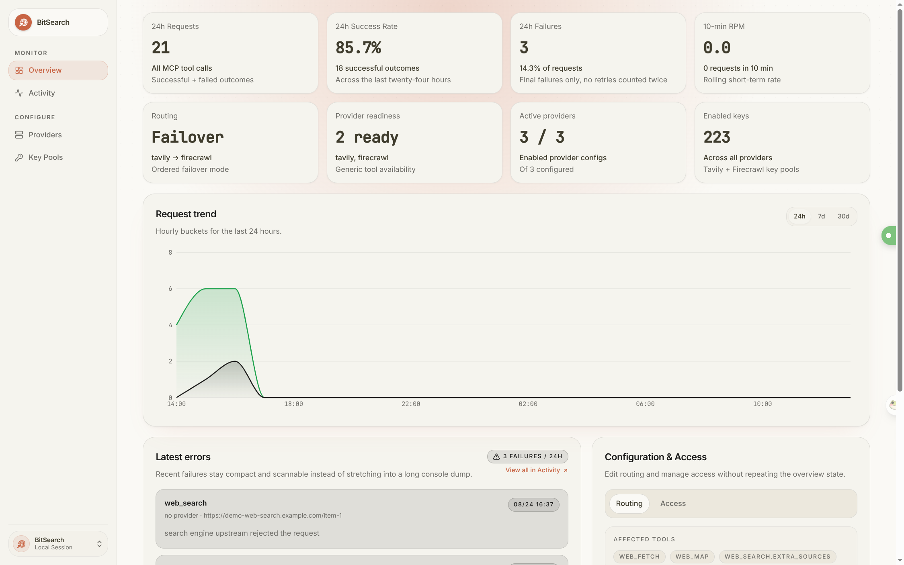
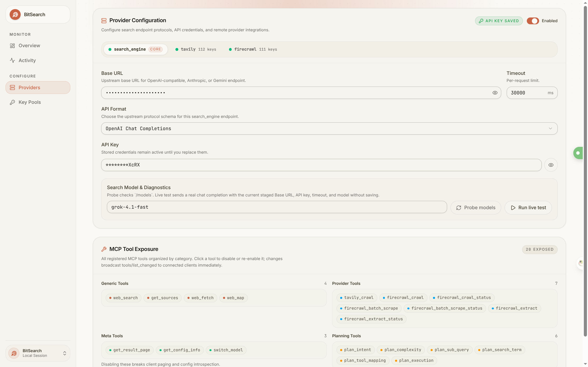
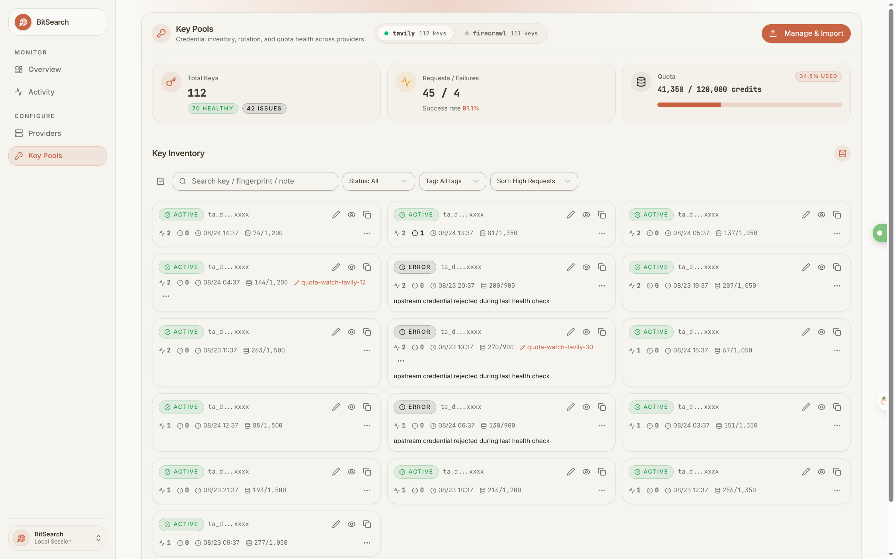
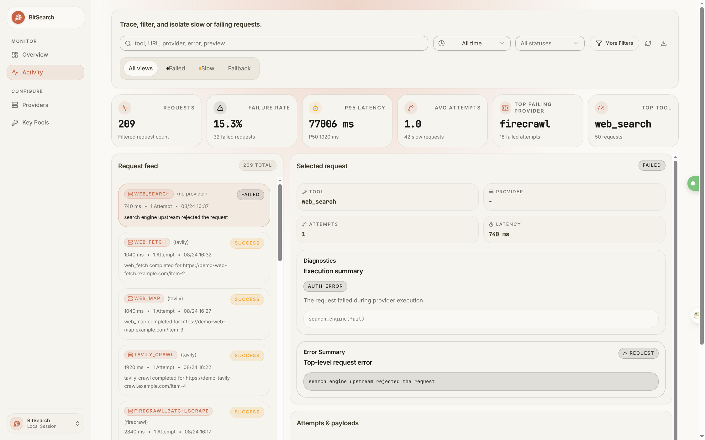

# BitSearch

English | [简体中文](README.zh-CN.md)

Self-hosted MCP search gateway and admin console for personal use, combining AI search, targeted crawling, and multi-round verification to reduce retrieval hallucinations.

<p>
  <a href="LICENSE"></a>
  <a href="https://www.typescriptlang.org/"></a>
  <a href="https://nodejs.org/"></a>
  <a href="Dockerfile"></a>
  <a href="https://github.com/Hedeoer/bitsearch/actions/workflows/docker-publish.yml"></a>
  <a href="https://hub.docker.com/r/hedeoerwang/bitsearch"></a>
  <a href="https://github.com/Hedeoer/bitsearch"></a>
</p>

## About

BitSearch combines two components into a single deployable service: an HTTP-based Model Context Protocol (MCP) server and a browser-based admin console. It is designed for individual users who want a unified, self-hosted entrypoint for web search, page extraction, and site-mapping workflows without giving up control over provider credentials, routing policies, or request observability.

Its core differentiator is not merely exposing search and crawl tools, but orchestrating a search-engine model alongside Tavily and Firecrawl in a disciplined retrieval loop: use the search engine to plan and search broadly, use Tavily or Firecrawl to fetch or crawl the most relevant targets, and cross-check evidence across multiple rounds before presenting conclusions. This makes BitSearch well suited for workflows that require stronger factual grounding and lower hallucination risk than one-shot search or single-pass scraping alone.

The backend exposes `20` MCP tools over Streamable HTTP, routes `web_search` between the `search_engine` LLM and the Tavily key pool, routes generic page retrieval and site mapping across Tavily and Firecrawl key pools, and provides provider-specific crawl, batch scrape, and structured extraction tools for advanced workflows. All telemetry is persisted in SQLite. The frontend provides a single-user workspace for provider configuration, key pool management, quota synchronization, MCP access control, operational metrics, and request activity inspection. BitSearch does not include multi-user or team collaboration features.

**Project links:**

- **GitHub:** `https://github.com/Hedeoer/bitsearch`
- **Docker Hub image:** `docker.io/hedeoerwang/bitsearch`

### Highlights

- **20 MCP Tools:** Covers web search, provider-specific extraction, result pagination, server configuration, and query planning.
- **Multi-Round Retrieval Loop:** Combines `search_engine`, Tavily, and Firecrawl into a coordinated search, crawl, and verification workflow rather than treating them as isolated tools.
- **Reduced Hallucinations:** Pairs broad discovery with targeted content extraction and cross-source verification.
- **Flexible Routing & Failover:** Supports configurable `web_search` upstream routing (`search_engine` and Tavily) as well as ordered failover across Tavily and Firecrawl for generic retrieval.
- **Key Pool Management:** Supports bulk key import, enable/disable controls, health testing, notes, quota synchronization, and CSV export.
- **Six-Phase Planning Engine:** Guides structured query decomposition and tool selection for complex research tasks.
- **Built-In Observability:** Tracks request logs, per-attempt statuses, dashboard metrics, and recent failures in the admin console.
- **Dual Deployment Modes:** Supports both native Node.js deployment from source and Docker Compose container deployment.

### Architecture





The MCP endpoint and Admin HTTP API share the same Express application context. The browser never accesses SQLite directly; all operations pass through authenticated admin routes, service modules, and repositories. `web_search` follows the configured search upstream routing (`search_engine`, Tavily, or automatic takeover between them), generic `web_fetch` and `web_map` calls use ordered failover across the Tavily and Firecrawl key pools, and provider-native tools invoke their respective upstream APIs directly.

### Why BitSearch

- **Discovery to Extraction:** Use a search-engine model for broad discovery and query planning, then hand off to Tavily and Firecrawl for targeted fetching, crawling, and structured extraction.
- **Evidence Verification:** Cross-check claims across multiple rounds instead of relying on a single search pass or scrape result.
- **Unified Control Plane:** Inspect keys, routing policies, quotas, request logs, and failure traces from one self-hosted admin console.

---

## Quick Start

### Docker (Recommended)

```bash
cp .env.example .env
docker compose up -d
docker exec -it bitsearch node -e "console.log(JSON.parse(require('fs').readFileSync('/app/data/runtime-secrets.json','utf8')).secrets.adminAuthKey)"
```

- **Admin Console:** `http://127.0.0.1:8097`
- **MCP Endpoint:** `http://127.0.0.1:8097/mcp`

### Native

```bash
npm ci
npm run build
set -a
source .env
set +a
bash scripts/start.sh
```

### Connect a Client

Connect your MCP client to the `/mcp` endpoint using a Bearer token:

```text
URL: http://127.0.0.1:8097/mcp
Authorization: Bearer <MCP_BEARER_TOKEN>
```

Detailed setup instructions, reverse proxy examples, and reference documentation are provided below.

### MCP Debugging Tools

BitSearch integrates three MCP validation and debugging tools: the official **MCP Inspector**, the official **MCP Conformance** suite, and **MCPJam**.

The local validation harness uses an isolated temporary SQLite database and deterministic test fixtures. It never reads or modifies production data in `data/`. The test proxy binds only to `127.0.0.1` and automatically injects the Bearer token.

```bash
# Official MCP Inspector: launch the interactive web debugging UI
npm run mcp:inspect

# Official MCP Inspector: run headless CLI smoke tests
npm run mcp:inspect:smoke

# Official MCP Conformance: run the supported core protocol scenarios
npm run mcp:conformance

# MCPJam: verify server connectivity, initialization, and tool discovery
npm run mcpjam:doctor

# Full local validation gate used by CI
npm run mcp:tooling
```

`mcp:inspect` launches the local Inspector web UI and connects it to an ephemeral BitSearch MCP instance. Production deployments continue to enforce `/mcp` authentication—to inspect a deployed server, enter its `/mcp` URL and `Authorization: Bearer <MCP_BEARER_TOKEN>` header directly in MCP Inspector.

MCPJam model evaluations require an external LLM API key and are excluded from the default CI workflow. To run evaluations against a test or staging server, export the target server URL, MCP token, model identifier, and LLM API key:

```bash
export MCP_SERVER_URL="http://127.0.0.1:8097/mcp"
export MCP_BEARER_TOKEN="<MCP_BEARER_TOKEN>"
export MCPJAM_MODEL="openai/gpt-4o-mini"
export MCPJAM_LLM_API_KEY="<LLM_API_KEY>"
npm run mcpjam:eval
```

Optional environment variables:

- `MCPJAM_ITERATIONS` (default: `10`)
- `MCPJAM_MIN_ACCURACY` (default: `0.9`)
- `MCPJAM_API_KEY` (uploads evaluation results to MCPJam when set)

The evaluation suite exercises BitSearch's search, page retrieval, site discovery, and result pagination workflows. Ensure the target instance has the required upstream providers configured before running it.

---

## Installation & Detailed Setup

### Prerequisites

| Deployment Mode | Requirements |
|---|---|
| **Native (npm)** | Node.js `22+`, npm `10+` |
| **Container (Docker)** | Docker `24+`, Docker Compose v2 |

### Installation

Shell examples below use `bash`. PowerShell equivalents are provided where commands differ.

1. **Clone the repository and install dependencies:**

   ```bash
   git clone https://github.com/Hedeoer/bitsearch.git
   cd bitsearch
   npm ci
   ```

2. **Copy the example environment file:**

   ```bash
   cp .env.example .env
   ```

   ```powershell
   Copy-Item .env.example .env
   ```

3. **Configure secrets (optional):**

   BitSearch defaults to zero-touch secret initialization: if secret variables in `.env` are left empty, the server automatically generates them on first boot and persists them to `data/runtime-secrets.json` alongside the SQLite database. Explicit environment variables always take precedence over persisted values.

   To manage secrets externally, set the following variables in `.env`:

   - `APP_ENCRYPTION_KEY` — AES-256-GCM key used to encrypt stored provider credentials (must remain constant, or existing encrypted keys become unreadable)
   - `ADMIN_AUTH_KEY` — authorization key used to sign in to the admin console
   - `SESSION_SECRET` — secret used to sign admin session cookies
   - `MCP_BEARER_TOKEN` — default Bearer token required by `/mcp` clients

4. **Generate random 32-byte hex secrets (if managing secrets manually):**

   ```bash
   node -e "console.log(require('crypto').randomBytes(32).toString('hex'))"
   ```

5. **Create the local data directory (for native npm deployment):**

   ```bash
   mkdir -p data
   ```

   ```powershell
   New-Item -ItemType Directory -Force data | Out-Null
   ```

If you let BitSearch auto-generate secrets, start the service once and read the persisted runtime secrets file:

```bash
cat data/runtime-secrets.json
```

For Docker deployments:

```bash
docker exec -it bitsearch cat /app/data/runtime-secrets.json
```

To print only the generated admin console login key (`secrets.adminAuthKey`):

```bash
node -e "console.log(JSON.parse(require('fs').readFileSync('data/runtime-secrets.json','utf8')).secrets.adminAuthKey)"
```

For Docker deployments:

```bash
docker exec -it bitsearch node -e "console.log(JSON.parse(require('fs').readFileSync('/app/data/runtime-secrets.json','utf8')).secrets.adminAuthKey)"
```

> **Note:** Docker Compose loads `.env` automatically. Native npm deployment does not automatically load `.env`; export the variables in your shell before starting the server.

### Deployment Paths

#### Option 1: Native Deployment (npm)

```bash
npm run build
set -a
source .env
set +a
bash scripts/start.sh
```

This builds both the frontend and backend bundles and serves the compiled admin UI and MCP server from a single Node.js process.

#### Option 2: Container Deployment (Docker Compose)

The standard Docker setup uses two files:

| File | Purpose | Notes |
|---|---|---|
| `.env` | Runtime configuration | Copy from `.env.example`. Empty secrets are generated and persisted on first boot. |
| `docker-compose.yml` | Service definition | Pulls `BITSEARCH_IMAGE` and configures restart policy, log rotation, named volume, and `/healthz` checks. |

**Container runtime variables:**

| Variable | Required | Default / Example | Description |
|---|---|---|---|
| `APP_PORT` | No | `8097` | TCP port exposed on the host and inside the container |
| `APP_HOST` | No | `0.0.0.0` | Bind address inside the container |
| `TRUST_PROXY` | No | `false` | Set to `true` when running behind Nginx, Caddy, Traefik, or another reverse proxy |
| `DATABASE_PATH` | No | `/app/data/bitsearch.db` | SQLite database file path inside the container (mounted to the `bitsearch_data` volume) |
| `RUNTIME_SECRETS_FILE` | No | `/app/data/runtime-secrets.json` | Optional override path for persisted runtime secrets |
| `APP_ENCRYPTION_KEY` | No (auto) | 32-byte hex string | Encrypts stored provider API keys (must remain stable across restarts) |
| `ADMIN_AUTH_KEY` | No (auto) | custom auth key | Authorization key used to sign in to the admin console |
| `SESSION_SECRET` | No (auto) | 32-byte hex string | Secret used to sign admin session cookies |
| `MCP_BEARER_TOKEN` | No (auto) | custom bearer token | Bearer token required by MCP clients calling `/mcp` |
| `BITSEARCH_IMAGE` | No | `docker.io/hedeoerwang/bitsearch:latest` | Container image reference used by `docker-compose.yml` |
| `NODE_ENV` | No | `production` | Preconfigured in `docker-compose.yml`; normally requires no change |

**Start with Docker Compose:**

```bash
cp .env.example .env
# Edit .env as needed
docker compose up -d
```

To pin a specific image tag, set `BITSEARCH_IMAGE` in `.env` rather than maintaining separate Compose files.

**Common Docker Compose commands:**

```bash
docker compose logs -f
docker compose down
docker compose pull
docker compose up -d
```

**Published Docker Hub tags (via GitHub Actions):**

- `latest` and `main` on pushes to the `main` branch
- `sha-<commit>` tags for exact commit traceability and rollback
- Semantic version tags (`X.Y.Z`, `X.Y`, `X`) when pushing Git tags matching `v*.*.*`

#### Option 3: Development Mode

For local development, run the Vite dev server and TSX backend watcher together:

```bash
# Starts the Express backend on 127.0.0.1:8098 and the Vite dev server on 5176
npm run dev
```

- **Admin Console (Vite):** `http://localhost:5176` (if port `5176` is in use, Vite automatically increments to the next available port; check terminal output for the active URL)
- **Backend API & MCP (TSX):** `http://127.0.0.1:8098`

**Development endpoints:**

- **Browser UI entrypoint:** `http://localhost:5176`
- **Health check:** `http://127.0.0.1:8098/healthz`
- **MCP endpoint:** `http://127.0.0.1:8098/mcp`

Use `http://localhost:5176` for browser verification during development; Vite proxies `/api` requests to `http://127.0.0.1:8098`.

### Reverse Proxy Example (Nginx)

When exposing BitSearch behind Nginx in production, set `TRUST_PROXY=true` in `.env` so the server derives the external scheme and host accurately for the Admin Console and MCP access panel.

Deploy BitSearch at the root of a dedicated domain (such as `https://bitsearch.example.com`), as the frontend router and backend routes use root-relative paths (`/`, `/api/admin`, and `/mcp`).

The Nginx configuration below includes the header forwarding and buffering directives required for `notifications/initialized` and long-lived Streamable HTTP MCP sessions.

<details>
<summary>Expand the full Nginx reverse proxy example</summary>

```nginx
upstream bitsearch_backend {
    server 127.0.0.1:8097;
    keepalive 32;
}

log_format bitsearch_mcp '$remote_addr - $remote_user [$time_local] '
                         '"$request" $status $body_bytes_sent '
                         'upstream_status="$upstream_status" '
                         'upstream_response_time="$upstream_response_time" '
                         'sid="$http_mcp_session_id" '
                         'proto="$http_mcp_protocol_version" '
                         'origin="$http_origin" '
                         'accept="$http_accept" '
                         'ua="$http_user_agent"';

server {
    listen 80;
    server_name bitsearch.example.com;
    return 301 https://$host$request_uri;
}

server {
    listen 443 ssl http2;
    server_name bitsearch.example.com;

    ssl_certificate     /etc/letsencrypt/live/bitsearch.example.com/fullchain.pem;
    ssl_certificate_key /etc/letsencrypt/live/bitsearch.example.com/privkey.pem;

    access_log /var/log/nginx/bitsearch_access.log;
    error_log  /var/log/nginx/bitsearch_error.log warn;

    location = /mcp {
        access_log /var/log/nginx/bitsearch_mcp_access.log bitsearch_mcp;

        proxy_pass http://bitsearch_backend;
        proxy_http_version 1.1;

        proxy_set_header Host $host;
        proxy_set_header X-Real-IP $remote_addr;
        proxy_set_header X-Forwarded-For $proxy_add_x_forwarded_for;
        proxy_set_header X-Forwarded-Proto $scheme;
        proxy_set_header X-Forwarded-Host $host;
        proxy_set_header Connection "";

        proxy_request_buffering off;
        proxy_buffering off;
        proxy_intercept_errors off;
        proxy_pass_request_headers on;

        proxy_pass_header Mcp-Session-Id;
        proxy_pass_header Content-Type;
        proxy_pass_header Cache-Control;

        chunked_transfer_encoding off;
        proxy_read_timeout 3600s;
        proxy_send_timeout 3600s;
    }

    location / {
        proxy_pass http://bitsearch_backend;
        proxy_http_version 1.1;

        proxy_set_header Host $host;
        proxy_set_header X-Real-IP $remote_addr;
        proxy_set_header X-Forwarded-For $proxy_add_x_forwarded_for;
        proxy_set_header X-Forwarded-Proto $scheme;
        proxy_set_header X-Forwarded-Host $host;
    }
}
```

</details>

For additional deployment details, see [DEPLOYMENT.md](DEPLOYMENT.md).

---

## Usage

### 1. Verify the Service Is Running

```bash
curl http://127.0.0.1:8097/healthz
```

Expected response:

```json
{"ok":true}
```

### 2. Connect an MCP Client

Below is a generic Streamable HTTP MCP client configuration. Field names vary across clients, but the endpoint URL and `Authorization` header are standard:

```json
{
  "mcpServers": {
    "bitsearch": {
      "type": "streamable-http",
      "url": "http://127.0.0.1:8097/mcp",
      "headers": {
        "Authorization": "Bearer <MCP_BEARER_TOKEN>"
      }
    }
  }
}
```

When deployed behind a reverse proxy, replace the local URL with your public endpoint (for example, `https://bitsearch.example.com/mcp`).

#### Claude Code

Register BitSearch as a remote HTTP MCP server in Claude Code:

```bash
claude mcp add --scope user --transport http bitsearch https://bitsearch.example.com/mcp \
  --header "Authorization: Bearer <MCP_BEARER_TOKEN>"
```

For project-scoped configuration, add a matching entry to `.mcp.json`:

```json
{
  "mcpServers": {
    "bitsearch": {
      "type": "http",
      "url": "https://bitsearch.example.com/mcp",
      "headers": {
        "Authorization": "Bearer ${BITSEARCH_MCP_TOKEN}"
      }
    }
  }
}
```

Export the token in your shell before launching Claude Code:

```bash
export BITSEARCH_MCP_TOKEN="<MCP_BEARER_TOKEN>"
```

#### Codex

Register BitSearch as a remote Streamable HTTP MCP server in Codex:

```bash
export BITSEARCH_MCP_TOKEN="<MCP_BEARER_TOKEN>"

codex mcp add bitsearch \
  --url https://bitsearch.example.com/mcp \
  --bearer-token-env-var BITSEARCH_MCP_TOKEN
```

Equivalent `~/.codex/config.toml` entry:

```toml
[mcp_servers.bitsearch]
url = "https://bitsearch.example.com/mcp"
bearer_token_env_var = "BITSEARCH_MCP_TOKEN"
```

#### Agent Skills-Compatible Clients

If your client supports the open Agent Skills specification, prefer `skill + mcp` over pasting the long companion prompt into every session.

This repository includes a standard skill package in `skills/bitsearch-research/`. It consolidates tool routing rules, source quality standards, retrieval workflows, and Planning Engine escalation criteria into a single reusable skill.

The MCP server also provides a concise protocol-level instruction block at initialization. That block supplements the Skill with live server routing context; it is advisory and does not replace the Skill or host-level security policies.

#### Option A: Install via the `skills` CLI (Recommended)

The [`skills`](https://github.com/vercel-labs/skills) CLI clones this repository, discovers `skills/bitsearch-research/`, detects installed coding agents, and installs the skill into each agent's target directory:

```bash
# Project-level install (interactive agent selection)
npx skills add Hedeoer/bitsearch

# User-wide install
npx skills add Hedeoer/bitsearch -g

# Non-interactive install into Claude Code only
npx skills add Hedeoer/bitsearch --skill bitsearch-research -a claude-code -g -y

# Preview discoverable skills without installing
npx skills add Hedeoer/bitsearch --list
```

`--skill bitsearch-research` matches the `name` field in `skills/bitsearch-research/SKILL.md`. Pass `-a` for each target agent (for example, `-a claude-code -a cursor -a codex`), or omit `-a` to select agents interactively.

#### Option B: Manual Copy

To install without the CLI, copy the skill directory directly:

```bash
# Project-level
mkdir -p .agents/skills
cp -R skills/bitsearch-research .agents/skills/

# User-wide
mkdir -p ~/.agents/skills
cp -R skills/bitsearch-research ~/.agents/skills/
```

If your client does not scan `.agents/skills/`, copy the directory into its native skills path (such as `.claude/skills/`, `~/.claude/skills/`, or `~/.codex/skills/`).

See [skills/README.md](skills/README.md) and [llmdoc/guides/using-bitsearch-with-agent-skills.md](llmdoc/guides/using-bitsearch-with-agent-skills.md) for template structure, client compatibility notes, and the local Agent Skills specification reference.

For an end-to-end verification walkthrough after connecting a client, see [llmdoc/guides/testing-bitsearch-with-natural-chat-prompts.md](llmdoc/guides/testing-bitsearch-with-natural-chat-prompts.md), which provides a natural-language test script covering search, source inspection, fetch, map, crawl, batch scrape, extraction, and Planning Engine escalation.

#### Disable Native Web Tools When Using BitSearch

Some clients include built-in web tools such as `WebSearch` or `WebFetch`. Unless those native tools are disabled locally, the client may bypass BitSearch MCP and its routing, citation, and planning rules.

- Always disable conflicting native web tools in the client configuration; BitSearch cannot disable host-owned tools remotely.

##### Claude Code

For a single session, disallow built-in web tools via CLI flags:

```bash
claude --disallowedTools WebSearch WebFetch
```

For persistent configuration, add a deny rule to `~/.claude/settings.json`, `.claude/settings.json`, or `.claude/settings.local.json`:

```json
{
  "permissions": {
    "deny": ["WebSearch", "WebFetch"]
  }
}
```

##### Codex

Codex CLI enables native live web search when launched with the `--search` flag. When using BitSearch, launch Codex without `--search` and remove the flag from any shell aliases, wrapper scripts, or profiles:

```bash
codex
```

```bash
codex -C /path/to/project
```

Keeping native search disabled ensures that BitSearch remains the sole web retrieval path in Codex.

### 3. Operate the Admin Console

1. Start BitSearch using one of the deployment modes above.
2. Open `http://127.0.0.1:8097` in your browser.
3. Sign in with `ADMIN_AUTH_KEY` (configured in `.env`, or stored in `data/runtime-secrets.json` under `secrets.adminAuthKey` if auto-generated).
4. Configure upstream provider URLs, import Tavily and Firecrawl API keys, and review the Admin and MCP access panels.
5. Use the **Overview**, **Providers**, **Keys**, and **Activity** workspaces to monitor routing posture, key health, and request traces.

### 4. Configure Providers

#### `search_engine` (Multi-Format AI Endpoint)

`search_engine` is the LLM search provider. A single configuration entry supports four upstream API protocols:

- `openai_chat_completions`
- `openai_responses`
- `anthropic_messages`
- `google_gemini`

In the **Providers** workspace, configure:

- **Base URL** — Root URL of the upstream API:
  - OpenAI: `https://api.openai.com/v1`
  - Ollama (local): `http://localhost:11434/v1`
  - Anthropic: `https://api.anthropic.com`
  - Google Gemini: `https://generativelanguage.googleapis.com/v1beta`
  - Compatible third-party relays are also supported (common path prefixes include `/v1`, `/anthropic`, and `/gemini`).
- **API Format** — Protocol matching the upstream endpoint:
  - `OpenAI Chat Completions`
  - `OpenAI Responses`
  - `Anthropic Messages`
  - `Google Gemini API`
- **API Key** — Upstream API credential (encrypted at rest with AES-256-GCM and never written to logs).
- **Model** — Default model identifier for LLM search (can be changed at runtime via the `switch_model` MCP tool).
- **Timeout** — Per-request timeout in milliseconds (`1,000`–`120,000`). Search completion calls automatically enforce an internal minimum of `120,000` ms so lower values do not truncate long-running searches.
- **Probe models** — Queries the upstream model list using the current staged settings without saving:
  - OpenAI formats query `/models`
  - Anthropic queries the Models API
  - Gemini queries `models.list`
- **Run live test** — Sends a live test search request using the staged Base URL, API format, API key, timeout, and model without saving changes.

#### Tavily (Key Pool)

Tavily powers the `web_search` answer upstream (in `tavily_first` and `tavily_only` modes), supplies extra sources for `web_search` (skipped when Tavily already produced the primary answer), handles `web_fetch` and `web_map` requests under generic routing, and backs the provider-specific `tavily_crawl` tool.

1. Obtain an API key at <https://tavily.com> (the free tier includes `1,000` API credits/month).
2. Open the **Keys** workspace, select **Tavily**, paste one or more keys (one per line), and click **Import**.
3. Keys are deduplicated automatically by fingerprint. Health status and credit quotas can be inspected and synced in the same workspace.
4. Default Base URL: `https://api.tavily.com` (leave unchanged unless routing through a custom proxy).

#### Firecrawl (Key Pool)

Firecrawl handles `web_fetch` (page scrape to Markdown), `web_map` (site URL discovery), `web_search` extra sources, and the asynchronous provider-specific tools `firecrawl_crawl`, `firecrawl_batch_scrape`, and `firecrawl_extract`.

1. Obtain an API key at <https://www.firecrawl.dev> (the free tier includes `500` credits/month).
2. Open the **Keys** workspace, select **Firecrawl**, paste one or more keys, and click **Import**.
3. Firecrawl quota aggregation assumes each imported key belongs to a distinct Firecrawl team. Avoid importing multiple keys from the same team if you rely on aggregate pool totals.
4. Default Base URL: `https://api.firecrawl.dev/v2` (leave unchanged unless routing through a custom proxy).

When you run **Sync** for Firecrawl keys, BitSearch queries:

- `GET /team/credit-usage` for remaining team credits
- `GET /team/credit-usage/historical` for credits used in the current billing period

The admin UI displays Firecrawl quota in a compact `used / remaining` format:

- **Key card:** `usedCredits / remainingCredits`
- **Pool summary:** `sum(usedCredits) / sum(remainingCredits)`

Internally, BitSearch derives total credits as `usedCredits + remainingCredits` for summary calculations while keeping the `used / remaining` display consistent with Tavily key cards.

#### Generic Retrieval Routing

Configured in the **Overview** workspace under **Configuration & Access → Routing**:

| Mode | Behavior |
|---|---|
| `single_provider` | Uses a single configured provider for `web_fetch`, `web_map`, and `web_search` extra sources |
| `ordered_failover` | Tries the primary provider first and fails over to the secondary provider when keys are unavailable or requests fail |

Generic retrieval routing applies only to `web_fetch`, `web_map`, and `web_search` extra sources. Provider-specific tools (`tavily_crawl` and `firecrawl_*`) always target their named provider and never fail over across providers.

#### Search Upstream Routing (`web_search`)

Configured in the **Providers** workspace under **Search Upstream**. Saving this card updates only the `web_search` answer routing mode without modifying generic retrieval routing or result-budget settings:

| Mode | Behavior |
|---|---|
| `llm_first` (default) | Queries the `search_engine` LLM first; Tavily takes over automatically on request failure or an empty answer |
| `llm_only` | Queries only the `search_engine` LLM; failures return an error directly |
| `tavily_first` | Queries the Tavily key pool first; the `search_engine` LLM takes over automatically on failure or an empty answer |
| `tavily_only` | Queries only the Tavily key pool; `web_search` operates without any `search_engine` configuration |

The Tavily search upstream calls `POST /search` with `search_depth: "advanced"` (2 credits), `include_answer: "advanced"`, `max_results: 5`, `chunks_per_source: 3`, and a dedicated `60,000` ms timeout, rotating across enabled Tavily keys in least-recently-used (LRU) order. HTTP status codes `432` (plan/key quota limit), `433` (PayGo limit), and `401` (invalid key) advance immediately to the next key in the pool. If Tavily returns no summarized answer, BitSearch assembles an answer locally only when usable HTTP(S) result items are present; if both the answer and usable sources are empty, the upstream attempt fails so takeover can proceed. LLM answers are validated after stripping `<think>` blocks and source-only sections. The `model` and `platform` parameters apply only to the `search_engine` upstream.

`PUT /api/admin/search-upstream` accepts `{ "searchUpstreamMode": "<mode>" }` and requires an authenticated admin session. Full-system `PUT /api/admin/system` requests that omit `searchUpstreamMode` preserve the currently stored mode, falling back to `llm_first` only when no mode has been saved yet.

Search request logs record every upstream and key attempt along with its HTTP status code, error category, and duration. When all attempts fail, `finalProvider` is recorded as `null`, and the per-attempt log entries drive Activity filters and key-pool request/failure counters.

#### MCP Large Result Handling

Retrieval tools can return payloads larger than an MCP client context window should consume in a single response. BitSearch persists complete tool outputs in SQLite as `bitsearch://results/{id}` artifacts, returns a bounded initial preview, and attaches pagination metadata:

- `result_id` / `result_uri` — Identifier and resource URI of the stored artifact
- `next_cursor` — Opaque cursor for the next page, or `null` when complete
- `truncated` — Whether the current preview or page is truncated
- `returned_chars`, `total_chars`, `returned_items`, `total_items` — Character and item counts for the current page and full artifact

To read subsequent pages, call `get_result_page` with `result_id` and `next_cursor`. For list-like artifacts containing an oversized individual item, pass `item_index` to `get_result_page` to page through that item's text.

The **MCP result budget** controls response sizing:

| Setting | Default | Description |
|---|---|---|
| `First Response Chars` | `20000` | Maximum character budget for the initial preview returned by a tool call |
| `Page Chars` | `50000` | Default character budget for follow-up `get_result_page` calls |
| `Hard Response Chars` | `200000` | Absolute per-response character ceiling, including explicit `max_chars` requests |

These budgets cap only the payload size returned per MCP response; they do not restrict how much content an upstream provider fetches or the size of the complete artifact stored in SQLite.

### Screenshots









---

## FAQ & Troubleshooting

- **Q: MCP connections time out or fail behind a reverse proxy?**
  **A:** Set `TRUST_PROXY=true` in `.env` when running behind Nginx, Caddy, or Traefik, confirm that proxy buffering is disabled on `/mcp`, and verify that the client's `Authorization: Bearer <MCP_BEARER_TOKEN>` header matches the active token.

- **Q: MCP tool calls fail after changing provider or tool exposure settings?**
  **A:** BitSearch dynamically updates the exposed tool surface when provider readiness or manual tool exposure changes and broadcasts `notifications/tools/list_changed`. If your MCP client does not handle dynamic tool-list notifications, reload the MCP server connection or start a new session so the client refreshes its tool list.

- **Q: What happens when a Tavily key runs out of quota?**
  **A:** When a Tavily key returns HTTP `429`, `432` (plan/key limit), `433` (PayGo limit), `401`, or `5xx`, BitSearch records the failure status on that key, rotates to the next enabled Tavily key in LRU order, and logs each attempt. If all Tavily keys fail, generic retrieval (`web_fetch`, `web_map`, and extra sources) fails over to Firecrawl when `ordered_failover` is active, while `web_search` in `tavily_first` mode fails over to `search_engine`.

- **Q: I lost `APP_ENCRYPTION_KEY`. Can I recover my stored API keys?**
  **A:** No. Provider keys are encrypted at rest with AES-256-GCM. Restore `data/runtime-secrets.json` or supply the original `APP_ENCRYPTION_KEY` to decrypt existing records. If encrypted credentials exist in SQLite but the encryption key is missing, BitSearch refuses to boot rather than silently generating a new key. If the key is permanently lost, clear the stored provider credentials and re-import your keys.

---

## Reference

### MCP Tools Reference

BitSearch exposes `20` MCP tools across four functional categories.

<details>
<summary>Expand the full MCP tools reference</summary>

#### 1. Search & Web Access

- **`web_search`** — Executes deep web search via the configured search upstream (`searchUpstreamMode`: `search_engine` LLM, Tavily Search API key pool, or automatic takeover between them). Caches sources server-side and returns a bounded answer preview with pagination metadata.
- **`get_sources`** — Retrieves a bounded page of cached source links from a prior `web_search` call using its `session_id`.
- **`web_fetch`** — Extracts clean Markdown from a target URL, stores the full result as a server-side artifact, and returns a bounded preview. Supports ordered failover across Tavily and Firecrawl key pools.
- **`web_map`** — Discovers and maps URLs on a target site via Tavily Map or Firecrawl Map, returning a bounded preview and pagination metadata.

#### 2. Provider-Specific Advanced Retrieval

- **`tavily_crawl`** — Synchronously crawls a website with Tavily and returns extracted page content in a single call.
- **`firecrawl_crawl`** / **`firecrawl_crawl_status`** — Submits and polls asynchronous Firecrawl site-crawl jobs.
- **`firecrawl_batch_scrape`** / **`firecrawl_batch_scrape_status`** — Submits and polls asynchronous multi-URL Firecrawl batch-scrape jobs.
- **`firecrawl_extract`** / **`firecrawl_extract_status`** — Submits and polls asynchronous structured extraction jobs driven by a prompt and/or JSON schema.

#### 3. Planning Engine

A six-phase scaffold for decomposing complex, multi-hop research queries into structured execution plans:

- **`plan_intent`** — Phase 1: Analyze user intent, domain, time sensitivity, and ambiguities.
- **`plan_complexity`** — Phase 2: Assess query complexity (`1`–`3`) and estimate sub-queries and tool calls.
- **`plan_sub_query`** — Phase 3: Decompose the research task into self-contained sub-queries with clear boundaries.
- **`plan_search_term`** — Phase 4: Define targeted search phrases for each sub-query and round.
- **`plan_tool_mapping`** — Phase 5: Map each sub-query to the appropriate retrieval tool.
- **`plan_execution`** — Phase 6: Organize parallel execution groups and sequential dependencies.

#### 4. System Management

- **`get_result_page`** — Reads a bounded page from a stored artifact using `result_id`, `next_cursor`, and optional `item_index`.
- **`get_config_info`** — Returns active server settings, tool surface status, key pool summaries, and a `search_engine` connectivity check.
- **`switch_model`** — Switches the default AI model used by the `search_engine` upstream in `web_search`.

</details>

### Fallback Companion Prompt (for clients without Agent Skills)

If your MCP client does not support Agent Skills, use the companion prompt below as a system-prompt fallback. It preserves BitSearch's evidence verification and output standards while enforcing rules for tool availability, generic vs. provider-specific selection, and asynchronous job polling.

<details>
<summary>Expand the full recommended companion prompt</summary>

```text
## 0. Language and Format Standards

- **Interaction Language**: Tools and models must interact exclusively in **English**; user outputs must be in **Chinese**.
- MUST ULTRA think in ENGLISH.
- **Formatting Requirements**: Use standard Markdown formatting. Code blocks and specific text results should be marked with backticks. Absolutely prohibited: do not add `<MARKDOWN>`, `<markdown>`, ```markdown or any other wrapper tags; do not put the entire reply into a code block; do not use four-layer or multi-layer wrappers. Directly output pure Markdown content so Cherry Studio / the client can normally render titles, lists, links, and code highlighting.

## 1. Search and Evidence Standards

Typically, raw web search results are only third-party suggestions and are not directly authoritative. They must be cross-verified with sources before being presented as reliable conclusions.

### Search Trigger Conditions

Strictly distinguish between internal knowledge and external knowledge. Avoid speculation based on general internal knowledge. When uncertain, explicitly inform the user.

For example, when using a library such as `fastapi` to encapsulate an API endpoint, even if you know common patterns internally, you must still rely on current search results or official documentation for reliable implementation.

### Search Execution Guidelines

- Use the `web_search` tool for open-web search and evidence gathering.
- Execute independent search requests in parallel; sequential execution applies only when dependencies exist.
- Evaluate search results for quality: relevance, source credibility, cross-source consistency, and completeness.
- Conduct supplementary searches if gaps remain.
- After `web_search`, use `get_sources` when source inspection, source listing, or citation-quality verification is needed.

### Source Quality Standards

- Key factual claims should be supported by at least 2 independent sources whenever possible.
- If relying on a single source, explicitly state that limitation.
- If sources conflict, present the conflicting evidence, assess credibility and timeliness, identify the stronger evidence if possible, or declare the discrepancy unresolved.
- Empirical conclusions must include confidence levels: `High`, `Medium`, or `Low`.
- Citation format: `[Author/Organization, Year/Date, Section/URL]`.
- Fabricated references are strictly prohibited.

## 2. Reasoning and Expression Principles

- Be concise, direct, and information-dense: use lists for discrete items and paragraphs for arguments.
- Challenge flawed premises: when user logic contains errors, pinpoint the issue with evidence.
- All conclusions must specify applicable conditions, scope boundaries, and known limitations.
- Avoid greetings, pleasantries, filler adjectives, and emotional expressions.
- When uncertain: state what is unknown and why before presenting what is confirmed.

## 3. BitSearch Tool Usage Rules

Choose tools by task shape, not by habit.

### Availability Rules

- Only use tools that are currently exposed by the MCP server.
- Do not assume `tavily_crawl` or any `firecrawl_*` tool is always available.
- If a tool is not currently exposed, do not plan around it and do not mention it as if it can be used.
- When unsure, rely on the currently visible tool list from the client.

### General Search / Discovery

- Use `web_search` when the task is to discover information on the open web, compare sources, or gather evidence across multiple sites.
- Use `get_sources` after `web_search` when exact source inspection, source listing, or citation support is required.

### Generic URL Retrieval

- Use `web_fetch` when the target is a single known URL and the goal is to read page content.
- Use `web_map` when the goal is to discover a site's URL structure only.
- Do not use `web_map` when the real goal is to obtain page content; `web_map` returns URLs, not full extracted content.

### Specialized Retrieval

- Use `tavily_crawl` when the task requires traversing one site and returning page content in one synchronous call.
- Use `firecrawl_batch_scrape` when there is already a list of known URLs and the task is to scrape them in parallel.
- Use `firecrawl_extract` when the desired output is structured fields or JSON, especially when a prompt and/or schema is involved.
- Use `firecrawl_crawl` only when the task truly requires deeper asynchronous site crawling.

### Selection Discipline

- Prefer `web_search`, `web_fetch`, and `web_map` for general tasks.
- Use `tavily_crawl` or `firecrawl_*` only when the task explicitly requires their specialized behavior.
- Do not choose provider-specific tools merely to bypass generic tools.
- Do not switch to provider-specific tools just to override generic retrieval routing.

### Async Tool Rules

- `tavily_crawl` is synchronous.
- `firecrawl_crawl` is asynchronous. After submission, always call `firecrawl_crawl_status` until the job reaches a terminal state, unless the user explicitly wants only the submission step.
- `firecrawl_batch_scrape` is asynchronous. After submission, always call `firecrawl_batch_scrape_status` until the job reaches a terminal state, unless the user explicitly wants only the submission step.
- `firecrawl_extract` is asynchronous. After submission, always call `firecrawl_extract_status` until the job reaches a terminal state, unless the user explicitly wants only the submission step.
- Never treat Firecrawl submit tools as final-result tools.
- Preserve and inspect terminal job states such as `completed`, `failed`, or `cancelled` exactly as returned.

### Large Result Rules

- Many BitSearch tools return a bounded preview plus `result_id`, `result_uri`, `next_cursor`, and `truncated` metadata instead of the full result.
- If `truncated` is true or `next_cursor` is present and more raw content is needed, call `get_result_page` with `result_id` and the latest `next_cursor`.
- For a large individual array item, call `get_result_page` with `result_id` and `item_index`.
- Do not assume the first tool response contains all fetched, crawled, scraped, or extracted content.

## 4. Workflow Preferences

Prefer the shortest correct workflow.

- If the goal is “find current information on the web”, prefer `web_search`.
- If the goal is “read one known page”, prefer `web_fetch`.
- If the goal is “list URLs on a site”, prefer `web_map`.
- If the goal is “read multiple pages from one site with content included”, prefer `tavily_crawl`.
- If the goal is “scrape multiple known URLs”, prefer `firecrawl_batch_scrape`.
- If the goal is “extract structured fields as JSON”, prefer `firecrawl_extract`.

### Planning Engine escalation

- Use the Planning Engine for ambiguous, multi-hop, or genuinely complex research tasks.
- For a simple single-lookup question, use the shortest correct retrieval path.

### Preferred Patterns

- Discovery first, extraction second:
  - Use `web_search` to find relevant pages.
  - Then use `web_fetch`, `tavily_crawl`, `firecrawl_batch_scrape`, or `firecrawl_extract` depending on the task.
- Known target first:
  - If the user already gave exact URLs or an exact site, skip `web_search` unless discovery is still necessary.
- Structured output first:
  - If the desired output is typed fields rather than prose, prefer `firecrawl_extract` over fetching raw text and manually parsing it.

### Avoid These Mistakes

- Do not use repeated `web_fetch` calls when `firecrawl_batch_scrape` is the better fit.
- Do not use `web_map + web_fetch` to simulate content-rich site crawling when `tavily_crawl` is the better fit.
- Do not use `web_fetch` when the required output is structured JSON and `firecrawl_extract` is more appropriate.
- Do not stop after a Firecrawl submit tool returns `id`; always continue with the corresponding status tool if the final result is needed.

## 5. Evidence Rules for Content Tools

Content tools retrieve or extract data, but credibility still depends on the source.

- For official docs, official vendor sites, official changelogs, and official product pages, direct content from those sources can be treated as primary evidence.
- For third-party sites, blogs, forums, or unclear pages, extracted content must still be cross-verified before presenting it as authoritative.
- If `firecrawl_extract` returns structured data from non-authoritative sources, treat it as extracted claims, not automatically verified facts.
- If the user asks for factual conclusions rather than raw extraction, verify those conclusions against authoritative sources where possible.

## 6. Output Discipline

- Default to Chinese in user-facing replies.
- Keep answers concise and high-density.
- Use explicit citations when the task is evidence-sensitive.
- If you are returning raw tool output, clearly separate raw results from analysis.
- If confidence is not high, say so explicitly.
```

</details>

### Project Structure

```text
src/
├── server/
│   ├── db/                 # SQLite database schema and instantiation
│   ├── http/               # Express admin routes, session auth, and middleware
│   ├── lib/                # Crypto, auth, HTTP helpers, and admin session store
│   ├── mcp/                # MCP SDK tool registrations, artifacts, and transports
│   ├── providers/          # Upstream adapters (Search Engine, Tavily, Firecrawl)
│   ├── repos/              # SQLite repositories (logs, keys, settings, artifacts)
│   ├── services/           # Core logic (search routing, key pools, planning, access)
│   ├── app-context.ts      # Shared AppContext interface across server modules
│   ├── main.ts             # Backend service entry point
│   ├── app.ts              # Express application assembly
│   └── bootstrap.ts        # Environment and runtime secret resolution
├── shared/
│   ├── contracts.ts        # Shared Zod schemas and API contracts
│   ├── tool-surface.ts     # Tool lists, routing modes, and SystemSettings contract
│   └── firecrawl-quota.ts  # Firecrawl quota calculation helpers
└── web/
    ├── components/         # Console layout, provider cards, charts, and activity UI
    ├── hooks/              # Custom React hooks (use-theme)
    ├── pages/              # Workspace views (Overview, Providers, Keys, Activity)
    ├── api.ts              # Frontend HTTP client
    ├── app-defaults.ts     # Default frontend state snapshots
    ├── format.ts           # Display formatting helpers
    ├── types.ts            # Frontend state and draft type definitions
    ├── toast-store.ts      # Toast notification store
    ├── LoginView.tsx       # Admin console login view
    ├── AppShell.tsx        # Top-level route table and layout shell
    ├── App.tsx             # Root application state and data synchronization
    ├── app.css             # Tailwind CSS v4 entry and custom styles
    ├── admin-theme.css     # Theme design tokens (@theme inline)
    └── main.tsx            # React DOM entry point
```

### Built With

- [TypeScript](https://www.typescriptlang.org/)
- [Node.js](https://nodejs.org/)
- [Express](https://expressjs.com/)
- [React](https://react.dev/)
- [Vite](https://vitejs.dev/)
- [Zod](https://zod.dev/)
- [Model Context Protocol SDK](https://github.com/modelcontextprotocol/typescript-sdk)
- SQLite (`node:sqlite`)
- Docker & Docker Compose

---

## Acknowledgments

BitSearch is inspired by [GrokSearch](https://github.com/GuDaStudio/GrokSearch) by GuDaStudio, building upon its AI-search and scraping fallback architecture with a self-hosted Admin Console, multi-provider Key Pools, and structured result pagination.

## Roadmap

- Add additional upstream provider adapters and per-tool routing policies.
- Expand automated test coverage for MCP transports, failover edge cases, and admin workflows.
- Publish structured release notes and versioned image channels for Docker Hub users.
- Extend dashboard telemetry and operational audit views.

## Contributing

See [CONTRIBUTING.md](CONTRIBUTING.md) for issue reporting guidelines, pull request workflow, coding conventions, and verification requirements.

## License

Distributed under the MIT License. See [LICENSE](LICENSE) for the full text.
