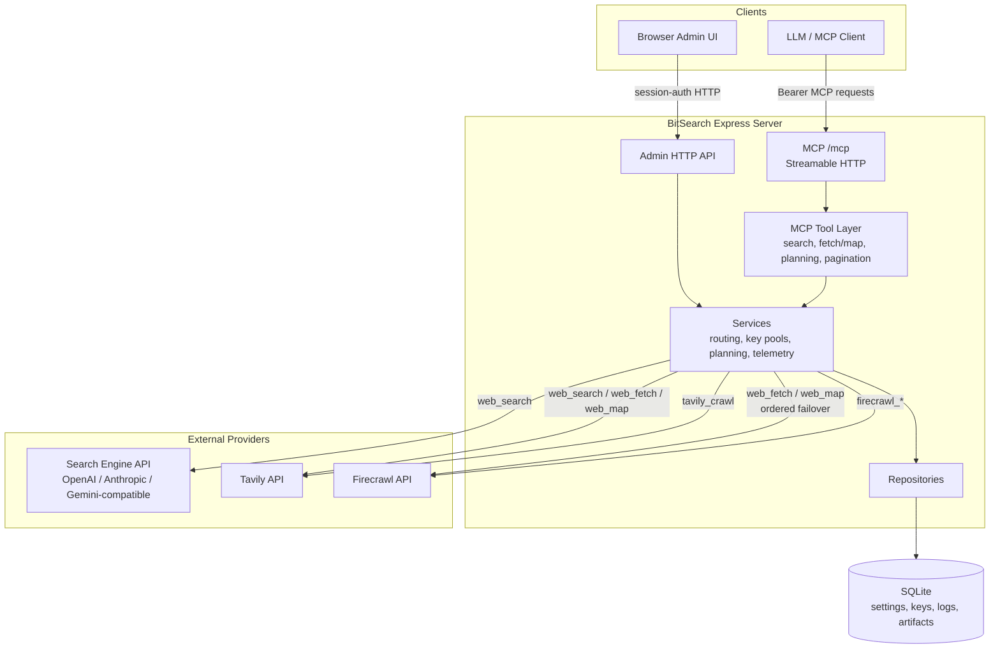

# BitSearch

[English](README.md) | 简体中文

面向个人使用的自托管 MCP 搜索网关与管理控制台，结合 AI 搜索、定向爬取和多轮验证，降低检索幻觉。

<p>
  <a href="LICENSE"></a>
  <a href="https://www.typescriptlang.org/"></a>
  <a href="https://nodejs.org/"></a>
  <a href="Dockerfile"></a>
  <a href="https://github.com/Hedeoer/bitsearch/actions/workflows/docker-publish.yml"></a>
  <a href="https://hub.docker.com/r/hedeoerwang/bitsearch"></a>
  <a href="https://github.com/Hedeoer/bitsearch"></a>
</p>

## 项目简介

BitSearch 将两个组件整合为单一可部署服务：基于 HTTP 的 Model Context Protocol（MCP）服务器与基于浏览器的管理控制台。它面向个人用户，为网页搜索、页面提取和站点映射工作流提供统一的自托管入口，同时完整保留对提供商凭证、路由策略和请求可观测性的控制权。

它的核心差异不只是暴露搜索与爬取工具，而是将搜索模型与 Tavily、Firecrawl 编排进受控的多轮检索闭环：先由搜索模型完成规划与广度搜索，再通过 Tavily 或 Firecrawl 获取或爬取高相关目标页面，最后经过多轮证据交叉核验后再输出结论。相比单次搜索或单次抓取，BitSearch 更适合需要扎实事实依据、低幻觉风险的研究工作流。

后端通过 Streamable HTTP 暴露 `20` 个 MCP 工具，在 `search_engine` LLM 与 Tavily 密钥池之间路由 `web_search`，在 Tavily 与 Firecrawl 密钥池之间路由通用页面提取与站点映射操作，并为复杂场景提供供应商专属的爬取、批量抓取和结构化提取工具。所有遥测数据均持久化在 SQLite 中。前端提供面向单用户的统一工作台，涵盖提供商配置、密钥池管理、配额同步、MCP 接入控制、运行指标看板以及请求活动追踪。BitSearch 不包含多用户或团队协作特性。

**项目链接：**

- **GitHub：** `https://github.com/Hedeoer/bitsearch`
- **Docker Hub 镜像：** `docker.io/hedeoerwang/bitsearch`

### 核心特性

- **20 个 MCP 工具：** 覆盖网页搜索、供应商专属提取、结果分页、服务配置与查询规划。
- **多轮检索闭环：** 将 `search_engine`、Tavily 和 Firecrawl 组合为协同的搜索、爬取与交叉验证流程，而非彼此孤立的工具。
- **降低检索幻觉：** 将广度发现、定向内容提取与多源交叉核查结合。
- **灵活路由与故障转移：** 支持可配置的 `web_search` 上游路由（`search_engine` 与 Tavily），以及通用检索在 Tavily 和 Firecrawl 之间的顺序故障转移。
- **密钥池管理：** 支持批量导入密钥、启用/禁用控制、连通性测试、备注、配额同步与 CSV 导出。
- **六阶段规划引擎：** 为复杂研究任务提供结构化的查询拆解与工具选型引导。
- **内置可观测性：** 在管理控制台中记录请求日志、单次尝试状态、仪表盘指标与近期错误。
- **双部署模式：** 支持基于 Node.js 的源码原生部署与 Docker Compose 容器部署。

### 系统架构




MCP 端点与管理 HTTP API 共享同一个 Express 应用上下文。浏览器不会直接读写 SQLite，所有操作均经过已认证的管理路由、服务模块和仓储层。`web_search` 遵循所配置的搜索上游路由（`search_engine`、Tavily 或二者之间的自动接管），通用 `web_fetch` 和 `web_map` 调用在 Tavily 与 Firecrawl 密钥池之间执行顺序故障转移，供应商原生工具则直接调用各自对应的上游 API。

### 为什么选择 BitSearch

- **从发现到提取：** 先用搜索模型完成广度发现与查询规划，再交由 Tavily 和 Firecrawl 执行定向提取、站点爬取与结构化抽取。
- **多轮证据核验：** 通过多轮交叉验证确认事实，而非轻信单次搜索或单页抓取结果。
- **统一控制平面：** 在一个自托管管理控制台中集中查看密钥、路由策略、配额、请求日志与失败链路。

---

## 快速开始

### Docker（推荐）

```bash
cp .env.example .env
docker compose up -d
docker exec -it bitsearch node -e "console.log(JSON.parse(require('fs').readFileSync('/app/data/runtime-secrets.json','utf8')).secrets.adminAuthKey)"
```

- **管理控制台：** `http://127.0.0.1:8097`
- **MCP 端点：** `http://127.0.0.1:8097/mcp`

### 原生部署

```bash
npm ci
npm run build
set -a
source .env
set +a
bash scripts/start.sh
```

### 连接客户端

使用 Bearer token 将 MCP 客户端连接到 `/mcp` 端点：

```text
URL: http://127.0.0.1:8097/mcp
Authorization: Bearer <MCP_BEARER_TOKEN>
```

详细配置步骤、反向代理示例和完整参考文档见下文。

### MCP 调试工具

BitSearch 集成了三套 MCP 验证与调试工具：官方 **MCP Inspector**、官方 **MCP Conformance** 一致性测试套件，以及 **MCPJam**。

本地验证套件使用隔离的临时 SQLite 数据库和固定测试夹具，不会读取或修改 `data/` 中的生产数据。测试代理仅绑定 `127.0.0.1`，并自动注入 Bearer token。

```bash
# Official MCP Inspector: launch the interactive web debugging UI
npm run mcp:inspect

# Official MCP Inspector: run headless CLI smoke tests
npm run mcp:inspect:smoke

# Official MCP Conformance: run the supported core protocol scenarios
npm run mcp:conformance

# MCPJam: verify server connectivity, initialization, and tool discovery
npm run mcpjam:doctor

# Full local validation gate used by CI
npm run mcp:tooling
```

`mcp:inspect` 会启动本地 Inspector Web 界面并连接到临时 BitSearch MCP 实例。生产部署仍强制启用 `/mcp` 认证——如需调试已部署服务，可在 MCP Inspector 中直接填写目标 `/mcp` 地址和 `Authorization: Bearer <MCP_BEARER_TOKEN>` 请求头。

MCPJam 模型评测依赖外部 LLM API 密钥，因此不包含在默认 CI 工作流中。要针对测试或预发布服务运行评测，请先导出目标服务地址、MCP 令牌、模型标识及对应的 LLM API 密钥：

```bash
export MCP_SERVER_URL="http://127.0.0.1:8097/mcp"
export MCP_BEARER_TOKEN="<MCP_BEARER_TOKEN>"
export MCPJAM_MODEL="openai/gpt-4o-mini"
export MCPJAM_LLM_API_KEY="<LLM_API_KEY>"
npm run mcpjam:eval
```

可选环境变量：

- `MCPJAM_ITERATIONS`（默认：`10`）
- `MCPJAM_MIN_ACCURACY`（默认：`0.9`）
- `MCPJAM_API_KEY`（设置后将评测结果上传至 MCPJam）

评测套件覆盖 BitSearch 的搜索、页面提取、站点发现与结果分页工作流。运行前请确认目标实例已配置所需的上游提供商。

---

## 安装与详细配置

### 环境要求

| 部署模式 | 环境要求 |
|---|---|
| **原生部署（npm）** | Node.js `22+`、npm `10+` |
| **容器部署（Docker）** | Docker `24+`、Docker Compose v2 |

### 安装步骤

以下 Shell 示例使用 `bash`，命令有差异处同时给出 PowerShell 写法。

1. **克隆仓库并安装依赖：**

   ```bash
   git clone https://github.com/Hedeoer/bitsearch.git
   cd bitsearch
   npm ci
   ```

2. **复制环境变量示例文件：**

   ```bash
   cp .env.example .env
   ```

   ```powershell
   Copy-Item .env.example .env
   ```

3. **配置密钥（可选）：**

   BitSearch 默认支持免配置密钥初始化：如果 `.env` 中的密钥变量留空，服务会在首次启动时自动生成随机密钥，并持久化到 SQLite 数据库同目录的 `data/runtime-secrets.json`。显式设置的环境变量始终优先于持久化文件中的值。

   如需在外部自行管理密钥，可在 `.env` 中显式设置：

   - `APP_ENCRYPTION_KEY` — 用于加密存储提供商凭证的 AES-256-GCM 密钥（必须保持恒定，否则已加密存储的密钥将无法解密）
   - `ADMIN_AUTH_KEY` — 登录管理控制台使用的认证密钥
   - `SESSION_SECRET` — 管理会话 Cookie 的签名密钥
   - `MCP_BEARER_TOKEN` — `/mcp` 客户端调用所需的默认 Bearer token

4. **生成随机 32 字节十六进制密钥（手动管理密钥时使用）：**

   ```bash
   node -e "console.log(require('crypto').randomBytes(32).toString('hex'))"
   ```

5. **创建本地数据目录（用于原生 npm 部署）：**

   ```bash
   mkdir -p data
   ```

   ```powershell
   New-Item -ItemType Directory -Force data | Out-Null
   ```

如果使用自动生成的运行时密钥，先启动一次服务，再读取持久化的密钥文件：

```bash
cat data/runtime-secrets.json
```

Docker 部署下执行：

```bash
docker exec -it bitsearch cat /app/data/runtime-secrets.json
```

如果只需要输出自动生成的管理控制台登录密钥（`secrets.adminAuthKey`）：

```bash
node -e "console.log(JSON.parse(require('fs').readFileSync('data/runtime-secrets.json','utf8')).secrets.adminAuthKey)"
```

Docker 部署下执行：

```bash
docker exec -it bitsearch node -e "console.log(JSON.parse(require('fs').readFileSync('/app/data/runtime-secrets.json','utf8')).secrets.adminAuthKey)"
```

> **注意：** Docker Compose 会自动加载 `.env`。原生 npm 部署不会自动读取 `.env`，启动服务前请先将 `.env` 中的变量导出到当前 Shell。

### 部署方式

#### 方式一：原生部署（npm）

```bash
npm run build
set -a
source .env
set +a
bash scripts/start.sh
```

该命令会构建前后端产物，并由单个 Node.js 进程同时提供编译后的管理界面与 MCP 服务。

#### 方式二：容器部署（Docker Compose）

标准 Docker 部署仅需两个文件：

| 文件 | 用途 | 说明 |
|---|---|---|
| `.env` | 运行时配置 | 从 `.env.example` 复制。留空的密钥会在首次启动时自动生成并持久化。 |
| `docker-compose.yml` | 服务编排定义 | 拉取 `BITSEARCH_IMAGE`，内置重启策略、日志轮转、命名数据卷及 `/healthz` 健康检查。 |

**容器运行时变量：**

| 变量 | 必填 | 默认值 / 示例 | 说明 |
|---|---|---|---|
| `APP_PORT` | 否 | `8097` | 宿主机与容器内暴露的 TCP 端口 |
| `APP_HOST` | 否 | `0.0.0.0` | 容器内监听地址 |
| `TRUST_PROXY` | 否 | `false` | 部署在 Nginx、Caddy、Traefik 等反向代理后方时设为 `true` |
| `DATABASE_PATH` | 否 | `/app/data/bitsearch.db` | 容器内 SQLite 数据库路径（已挂载至 `bitsearch_data` 卷） |
| `RUNTIME_SECRETS_FILE` | 否 | `/app/data/runtime-secrets.json` | 可选，覆盖运行时密钥持久化文件的路径 |
| `APP_ENCRYPTION_KEY` | 否（自动） | 32 字节十六进制字符串 | 加密已存储的提供商 API 密钥（跨重启必须保持不变） |
| `ADMIN_AUTH_KEY` | 否（自动） | 自定义认证密钥 | 登录管理控制台所需的认证密钥 |
| `SESSION_SECRET` | 否（自动） | 32 字节十六进制字符串 | 管理会话 Cookie 签名密钥 |
| `MCP_BEARER_TOKEN` | 否（自动） | 自定义 Bearer token | MCP 客户端调用 `/mcp` 时所需的 Bearer token |
| `BITSEARCH_IMAGE` | 否 | `docker.io/hedeoerwang/bitsearch:latest` | `docker-compose.yml` 使用的容器镜像引用 |
| `NODE_ENV` | 否 | `production` | `docker-compose.yml` 已预设，通常无需修改 |

**使用 Docker Compose 启动：**

```bash
cp .env.example .env
# Edit .env as needed
docker compose up -d
```

如需固定特定镜像标签，直接修改 `.env` 中的 `BITSEARCH_IMAGE`，无需维护多份 Compose 文件。

**常用 Docker Compose 命令：**

```bash
docker compose logs -f
docker compose down
docker compose pull
docker compose up -d
```

**GitHub Actions 自动发布的 Docker Hub 标签：**

- 推送到 `main` 分支时更新 `latest` 与 `main`
- 生成 `sha-<commit>` 标签，便于精确版本追溯与回滚
- 推送匹配 `v*.*.*` 的 Git 标签时，发布语义化版本标签（`X.Y.Z`、`X.Y`、`X`）

#### 方式三：开发模式

日常本地开发时，同时启动 Vite 开发服务器与 TSX 后端热重载进程：

```bash
# Starts the Express backend on 127.0.0.1:8098 and the Vite dev server on 5176
npm run dev
```

- **管理控制台（Vite）：** `http://localhost:5176`（若 `5176` 端口被占用，Vite 会自动递增到下一个可用端口，请以终端输出为准）
- **后端 API 与 MCP（TSX）：** `http://127.0.0.1:8098`

**开发模式常用地址：**

- **浏览器界面入口：** `http://localhost:5176`
- **健康检查：** `http://127.0.0.1:8098/healthz`
- **MCP 端点：** `http://127.0.0.1:8098/mcp`

本地开发时请通过 `http://localhost:5176` 访问界面，Vite 会自动将 `/api` 请求代理至 `http://127.0.0.1:8098`。

### 反向代理示例（Nginx）

在生产环境中通过 Nginx 暴露 BitSearch 时，请在 `.env` 中设置 `TRUST_PROXY=true`，以便服务为管理控制台和 MCP 接入面板正确识别外部协议与域名。

建议将 BitSearch 部署在独立域名的根路径（例如 `https://bitsearch.example.com`），因为前端路由与后端接口均使用根路径（`/`、`/api/admin` 和 `/mcp`）。

下方完整 Nginx 配置包含 `notifications/initialized` 及长连接 Streamable HTTP MCP 会话所需的请求头透传与缓冲关闭指令。

<details>
<summary>展开完整 Nginx 反向代理配置示例</summary>

```nginx
upstream bitsearch_backend {
    server 127.0.0.1:8097;
    keepalive 32;
}

log_format bitsearch_mcp '$remote_addr - $remote_user [$time_local] '
                         '"$request" $status $body_bytes_sent '
                         'upstream_status="$upstream_status" '
                         'upstream_response_time="$upstream_response_time" '
                         'sid="$http_mcp_session_id" '
                         'proto="$http_mcp_protocol_version" '
                         'origin="$http_origin" '
                         'accept="$http_accept" '
                         'ua="$http_user_agent"';

server {
    listen 80;
    server_name bitsearch.example.com;
    return 301 https://$host$request_uri;
}

server {
    listen 443 ssl http2;
    server_name bitsearch.example.com;

    ssl_certificate     /etc/letsencrypt/live/bitsearch.example.com/fullchain.pem;
    ssl_certificate_key /etc/letsencrypt/live/bitsearch.example.com/privkey.pem;

    access_log /var/log/nginx/bitsearch_access.log;
    error_log  /var/log/nginx/bitsearch_error.log warn;

    location = /mcp {
        access_log /var/log/nginx/bitsearch_mcp_access.log bitsearch_mcp;

        proxy_pass http://bitsearch_backend;
        proxy_http_version 1.1;

        proxy_set_header Host $host;
        proxy_set_header X-Real-IP $remote_addr;
        proxy_set_header X-Forwarded-For $proxy_add_x_forwarded_for;
        proxy_set_header X-Forwarded-Proto $scheme;
        proxy_set_header X-Forwarded-Host $host;
        proxy_set_header Connection "";

        proxy_request_buffering off;
        proxy_buffering off;
        proxy_intercept_errors off;
        proxy_pass_request_headers on;

        proxy_pass_header Mcp-Session-Id;
        proxy_pass_header Content-Type;
        proxy_pass_header Cache-Control;

        chunked_transfer_encoding off;
        proxy_read_timeout 3600s;
        proxy_send_timeout 3600s;
    }

    location / {
        proxy_pass http://bitsearch_backend;
        proxy_http_version 1.1;

        proxy_set_header Host $host;
        proxy_set_header X-Real-IP $remote_addr;
        proxy_set_header X-Forwarded-For $proxy_add_x_forwarded_for;
        proxy_set_header X-Forwarded-Proto $scheme;
        proxy_set_header X-Forwarded-Host $host;
    }
}
```

</details>

更多部署细节请参阅 [DEPLOYMENT.md](DEPLOYMENT.md)。

---

## 使用指南

### 1. 验证服务运行状态

```bash
curl http://127.0.0.1:8097/healthz
```

预期响应：

```json
{"ok":true}
```

### 2. 连接 MCP 客户端

以下为通用的 Streamable HTTP MCP 客户端配置示例。不同客户端的字段名称可能略有差异，核心是端点 URL 与 `Authorization` 请求头：

```json
{
  "mcpServers": {
    "bitsearch": {
      "type": "streamable-http",
      "url": "http://127.0.0.1:8097/mcp",
      "headers": {
        "Authorization": "Bearer <MCP_BEARER_TOKEN>"
      }
    }
  }
}
```

如果部署在反向代理后方，请将本地地址替换为公开端点（例如 `https://bitsearch.example.com/mcp`）。

#### Claude Code

在 Claude Code 中将 BitSearch 注册为远程 HTTP MCP 服务器：

```bash
claude mcp add --scope user --transport http bitsearch https://bitsearch.example.com/mcp \
  --header "Authorization: Bearer <MCP_BEARER_TOKEN>"
```

如需使用项目级配置，可在项目根目录的 `.mcp.json` 中添加：

```json
{
  "mcpServers": {
    "bitsearch": {
      "type": "http",
      "url": "https://bitsearch.example.com/mcp",
      "headers": {
        "Authorization": "Bearer ${BITSEARCH_MCP_TOKEN}"
      }
    }
  }
}
```

启动 Claude Code 前在当前 Shell 中导出令牌环境变量：

```bash
export BITSEARCH_MCP_TOKEN="<MCP_BEARER_TOKEN>"
```

#### Codex

在 Codex 中将 BitSearch 注册为远程 Streamable HTTP MCP 服务器：

```bash
export BITSEARCH_MCP_TOKEN="<MCP_BEARER_TOKEN>"

codex mcp add bitsearch \
  --url https://bitsearch.example.com/mcp \
  --bearer-token-env-var BITSEARCH_MCP_TOKEN
```

等价的 `~/.codex/config.toml` 配置：

```toml
[mcp_servers.bitsearch]
url = "https://bitsearch.example.com/mcp"
bearer_token_env_var = "BITSEARCH_MCP_TOKEN"
```

#### 兼容 Agent Skills 的客户端

如果客户端支持开放的 Agent Skills 规范，推荐使用 `skill + mcp` 组合，无需在每次会话中手动粘贴长篇配套提示词。

本仓库在 `skills/bitsearch-research/` 下内置了标准 Skill 包，将工具路由准则、信源质量规范、检索流程与规划引擎升级条件整合为可直接复用的 Skill。

MCP 服务器在初始化握手时也会返回精简的协议级使用提示，用于补充当前服务的实时路由状态；该提示仅作参考，不会替代 Skill 或宿主自身的安全策略。

#### 方式 A：通过 `skills` CLI 安装（推荐）

[`skills`](https://github.com/vercel-labs/skills) CLI 会自动克隆本仓库、发现 `skills/bitsearch-research/`、识别本机已安装的编码 Agent，并将 Skill 安装到对应的目录：

```bash
# Project-level install (interactive agent selection)
npx skills add Hedeoer/bitsearch

# User-wide install
npx skills add Hedeoer/bitsearch -g

# Non-interactive install into Claude Code only
npx skills add Hedeoer/bitsearch --skill bitsearch-research -a claude-code -g -y

# Preview discoverable skills without installing
npx skills add Hedeoer/bitsearch --list
```

`--skill bitsearch-research` 对应 `skills/bitsearch-research/SKILL.md` 中的 `name` 字段。可通过 `-a` 指定一个或多个目标 Agent（例如 `-a claude-code -a cursor -a codex`），也可省略 `-a` 进行交互式选择。

#### 方式 B：手动复制安装

如果不使用 CLI，可以直接复制 Skill 目录：

```bash
# Project-level
mkdir -p .agents/skills
cp -R skills/bitsearch-research .agents/skills/

# User-wide
mkdir -p ~/.agents/skills
cp -R skills/bitsearch-research ~/.agents/skills/
```

如果客户端不扫描 `.agents/skills/`，请将该目录复制到客户端原生的 Skills 路径（例如 `.claude/skills/`、`~/.claude/skills/` 或 `~/.codex/skills/`）。

关于模板结构、客户端兼容性说明及 Agent Skills 规范快照，请参阅 [skills/README.md](skills/README.md) 与 [llmdoc/guides/using-bitsearch-with-agent-skills.md](llmdoc/guides/using-bitsearch-with-agent-skills.md)。

连接客户端后，如需执行端到端自然语言验收，可参考 [llmdoc/guides/testing-bitsearch-with-natural-chat-prompts.md](llmdoc/guides/testing-bitsearch-with-natural-chat-prompts.md) 中的单会话测试脚本，完整验证搜索、信源核查、抓取、站点映射、爬取、批量抓取、结构化提取及规划引擎行为。

#### 使用 BitSearch 时禁用客户端原生网页工具

部分客户端内置了 `WebSearch`、`WebFetch` 等原生网页工具。如果不先在客户端本地禁用这些工具，客户端可能会绕过 BitSearch MCP 及其路由、引用和规划规则。

- 请在客户端本地配置中禁用冲突的原生网页工具；BitSearch 无法从服务端远程关闭宿主自带的工具。

##### Claude Code

单次会话可通过命令行参数禁用内置网页工具：

```bash
claude --disallowedTools WebSearch WebFetch
```

持久化配置可在 `~/.claude/settings.json`、`.claude/settings.json` 或 `.claude/settings.local.json` 中添加拒绝规则：

```json
{
  "permissions": {
    "deny": ["WebSearch", "WebFetch"]
  }
}
```

##### Codex

Codex CLI 在传入 `--search` 参数时会启用原生实时网页搜索。使用 BitSearch 时，请不要附带 `--search` 启动 Codex，并从 Shell 别名、包装脚本或配置文件中移除该参数：

```bash
codex
```

```bash
codex -C /path/to/project
```

保持原生搜索关闭可确保 BitSearch 成为 Codex 中唯一的网页检索通道。

### 3. 操作管理控制台

1. 使用上述任一部署模式启动 BitSearch。
2. 在浏览器中打开 `http://127.0.0.1:8097`。
3. 使用 `ADMIN_AUTH_KEY` 登录（来自 `.env`，或自动生成时位于 `data/runtime-secrets.json` 的 `secrets.adminAuthKey` 字段）。
4. 配置上游提供商 Base URL，导入 Tavily 与 Firecrawl API 密钥，并检查管理端与 MCP 接入面板。
5. 通过 **Overview**、**Providers**、**Keys** 和 **Activity** 四个工作区监控路由态势、密钥健康度与请求轨迹。

### 4. 配置上游提供商

#### `search_engine`（多协议 AI 搜索端点）

`search_engine` 是 LLM 搜索提供商，单个配置入口支持四种上游 API 协议：

- `openai_chat_completions`
- `openai_responses`
- `anthropic_messages`
- `google_gemini`

在 **Providers** 工作区中可配置以下参数：

- **Base URL** — 上游 API 根地址：
  - OpenAI：`https://api.openai.com/v1`
  - Ollama（本地）：`http://localhost:11434/v1`
  - Anthropic：`https://api.anthropic.com`
  - Google Gemini：`https://generativelanguage.googleapis.com/v1beta`
  - 同样支持兼容的第三方中转服务（常见路径前缀包括 `/v1`、`/anthropic` 和 `/gemini`）。
- **API Format** — 与上游端点匹配的协议格式：
  - `OpenAI Chat Completions`
  - `OpenAI Responses`
  - `Anthropic Messages`
  - `Google Gemini API`
- **API Key** — 上游 API 密钥（使用 AES-256-GCM 加密落盘，绝不写入日志）。
- **Model** — LLM 搜索使用的默认模型标识（运行时可通过 `switch_model` MCP 工具动态切换）。
- **Timeout** — 单次请求超时时间，单位毫秒（`1,000`–`120,000`）。搜索生成请求在内部会自动启用至少 `120,000` ms 的超时下限，因此设置较小的值不会截断耗时较长的搜索响应。
- **Probe models** — 使用当前暂存配置探测上游模型列表（无需先保存）：
  - OpenAI 格式请求 `/models`
  - Anthropic 请求其 Models API
  - Gemini 请求 `models.list`
- **Run live test** — 使用当前暂存的 Base URL、API 格式、API 密钥、超时和模型发送一次真实搜索测试请求（无需先保存）。

#### Tavily（密钥池）

Tavily 同时承担四项职责：在 `tavily_first` 与 `tavily_only` 模式下作为 `web_search` 的答案上游、为 `web_search` 提供补充来源（当 Tavily 已生成主答案时自动跳过）、在通用路由下处理 `web_fetch` 与 `web_map` 请求，以及驱动供应商专属的 `tavily_crawl` 工具。

1. 前往 <https://tavily.com> 获取 API 密钥（免费额度包含每月 `1,000` API credits）。
2. 打开 **Keys** 工作区，选择 **Tavily**，按行粘贴一个或多个密钥，点击 **Import**。
3. 系统会按指纹自动去重，可在同一工作区查看和同步健康状态与额度。
4. 默认 Base URL：`https://api.tavily.com`（除非使用自定义代理，否则保持默认即可）。

#### Firecrawl（密钥池）

Firecrawl 负责 `web_fetch`（页面抓取转 Markdown）、`web_map`（站点 URL 发现）、`web_search` 补充来源，以及供应商专属异步工具 `firecrawl_crawl`、`firecrawl_batch_scrape` 和 `firecrawl_extract`。

1. 前往 <https://www.firecrawl.dev> 获取 API 密钥（免费额度包含每月 `500` credits）。
2. 打开 **Keys** 工作区，选择 **Firecrawl**，粘贴一个或多个密钥，点击 **Import**。
3. Firecrawl 额度汇总假定每把导入的密钥归属不同的 Firecrawl 团队；若依赖池总额统计，请勿在同一密钥池中导入同一团队的多把密钥。
4. 默认 Base URL：`https://api.firecrawl.dev/v2`（除非使用自定义代理，否则保持默认即可）。

在管理台对 Firecrawl 密钥执行 **Sync** 时，BitSearch 会调用：

- `GET /team/credit-usage` 获取团队剩余额度
- `GET /team/credit-usage/historical` 获取当前计费周期已用额度

管理界面以紧凑的 `已用 / 剩余` 格式展示 Firecrawl 额度：

- **单卡展示：** `usedCredits / remainingCredits`
- **池汇总展示：** `sum(usedCredits) / sum(remainingCredits)`

在内部计算中，BitSearch 以 `usedCredits + remainingCredits` 推导总额度，并在界面上保持与 Tavily 卡片一致的 `已用 / 剩余` 展示格式。

#### 通用检索路由（Generic Retrieval Routing）

在 **Overview** 工作区的 **Configuration & Access → Routing** 中配置：

| 模式 | 行为 |
|---|---|
| `single_provider` | `web_fetch`、`web_map` 与 `web_search` 补充来源仅使用单一指定提供商 |
| `ordered_failover` | 优先使用主提供商，当无可用密钥或请求失败时自动回退到备选提供商 |

通用检索路由仅作用于 `web_fetch`、`web_map` 和 `web_search` 补充来源。供应商专属工具（`tavily_crawl` 与 `firecrawl_*`）始终直接调用其命名提供商，不会跨提供商故障转移。

#### 搜索上游路由（`web_search`）

在 **Providers** 工作区的 **Search Upstream** 卡片中配置。保存该卡片仅更新 `web_search` 的答案上游模式，不会改动通用检索路由或结果预算设置：

| 模式 | 行为 |
|---|---|
| `llm_first`（默认） | 优先查询 `search_engine` LLM；当请求失败或返回空答案时由 Tavily 自动接管 |
| `llm_only` | 仅查询 `search_engine` LLM；失败时直接返回错误 |
| `tavily_first` | 优先查询 Tavily 密钥池；当请求失败或返回空答案时由 `search_engine` LLM 自动接管 |
| `tavily_only` | 仅查询 Tavily 密钥池；无需配置 `search_engine` 即可正常使用 `web_search` |

Tavily 搜索上游调用 `POST /search`，固定使用 `search_depth: "advanced"`（每次消耗 2 credits）、`include_answer: "advanced"`、`max_results: 5`、`chunks_per_source: 3` 以及独立的 `60,000` ms 超时，并按最近最少使用（LRU）顺序轮换已启用的 Tavily 密钥。遇到 HTTP `432`（套餐/密钥额度上限）、`433`（PayGo 上限）或 `401`（密钥无效）时，会立即切换到池中的下一把密钥。若 Tavily 未返回总结答案，BitSearch 仅在存在有效 HTTP(S) 结果条目时才会本地组装答案；若总结答案与有效来源同时为空，则判定该上游尝试失败，以便触发接管流程。LLM 答案会在剥离 `<think>` 思考块并分离纯来源段落后校验是否为空。`model` 与 `platform` 参数仅对 `search_engine` 上游生效。

`PUT /api/admin/search-upstream` 接收 `{ "searchUpstreamMode": "<mode>" }` 并要求已登录的管理会话。完整系统设置接口 `PUT /api/admin/system` 在请求体省略 `searchUpstreamMode` 时会保留数据库中已保存的模式，仅在尚未保存过任何模式时回退至默认 `llm_first`。

搜索请求日志会完整记录每一次上游与密钥尝试及其 HTTP 状态码、错误分类和耗时。当所有尝试均失败时，`finalProvider` 记录为 `null`，由各条尝试记录支撑 Activity 筛选器及密钥池的请求数/失败数统计。

#### MCP 大结果分页治理

检索工具返回的内容可能远超 MCP 客户端单次上下文窗口的安全承载范围。BitSearch 会将完整工具输出作为 `bitsearch://results/{id}` artifact 保存在服务端 SQLite 中，首次响应仅返回有界预览并附带分页元数据：

- `result_id` / `result_uri` — 已保存 artifact 的唯一标识与资源 URI
- `next_cursor` — 读取下一页的不透明游标，读完时为 `null`
- `truncated` — 当前预览或分页是否发生截断
- `returned_chars`、`total_chars`、`returned_items`、`total_items` — 当前页与完整结果的字符数及条目数统计

如需继续读取后续内容，请携带 `result_id` 与最新的 `next_cursor` 调用 `get_result_page`。若列表类结果中的单个条目体积过大，可传入 `item_index` 调用 `get_result_page`，对该条目按文本分页读取。

**MCP 结果预算（Result Budget）** 控制单次响应体积：

| 设置项 | 默认值 | 说明 |
|---|---|---|
| `First Response Chars` | `20000` | 工具调用首次返回预览的最大字符预算 |
| `Page Chars` | `50000` | 后续 `get_result_page` 调用的默认单页字符预算 |
| `Hard Response Chars` | `200000` | 单次响应的绝对字符上限（同样约束显式传入的 `max_chars`） |

上述预算仅限制单次返回给 MCP 客户端的响应大小，不限制上游提供商实际的抓取/提取规模，也不限制 SQLite 中完整 artifact 的存储大小。

### 界面预览


---

## 常见问题与排障

- **问：在反向代理后方连接 MCP 超时或失败？**
  **答：** 部署在 Nginx、Caddy 或 Traefik 后方时，请确认 `.env` 中已设置 `TRUST_PROXY=true`，确认 `/mcp` 路径已关闭代理缓冲（buffering），并核对客户端配置的 `Authorization: Bearer <MCP_BEARER_TOKEN>` 与当前生效令牌一致。

- **问：在管理台修改提供商或工具暴露设置后，MCP 工具调用报错？**
  **答：** 当提供商可用性或手动工具开关发生变化时，BitSearch 会动态更新暴露的工具列表并广播 `notifications/tools/list_changed`。如果客户端不支持动态工具列表通知，请在客户端中重新加载 MCP 服务器连接或新建会话以刷新工具列表。

- **问：Tavily 密钥额度耗尽后会发生什么？**
  **答：** 当某把 Tavily 密钥返回 HTTP `429`、`432`（套餐/密钥额度上限）、`433`（PayGo 上限）、`401` 或 `5xx` 时，BitSearch 会在该密钥上记录失败状态，按 LRU 顺序轮换到下一把已启用的 Tavily 密钥，并记录每次尝试明细。若所有 Tavily 密钥均失败，通用检索（`web_fetch`、`web_map` 及补充来源）在 `ordered_failover` 模式下会自动切换到 Firecrawl，而 `tavily_first` 模式下的 `web_search` 会自动切换到 `search_engine`。

- **问：丢失了 `APP_ENCRYPTION_KEY`，还能恢复已保存的 API 密钥吗？**
  **答：** 不能。提供商密钥采用 AES-256-GCM 加密存储，必须恢复 `data/runtime-secrets.json` 或提供原 `APP_ENCRYPTION_KEY` 才能解密已有记录。若 SQLite 中存在已加密的凭证但缺少加密密钥，BitSearch 会拒绝启动，以避免静默生成新密钥导致数据不可读。如果密钥已无法找回，只能清空已保存的提供商凭证并重新导入密钥。

---

## 参考文档

### MCP 工具参考

BitSearch 向 MCP 客户端暴露四大类共 `20` 个工具。

<details>
<summary>展开完整 MCP 工具参考</summary>

#### 1. 搜索与网页访问

- **`web_search`** — 通过所配置的搜索上游（`searchUpstreamMode`：`search_engine` LLM、Tavily Search API 密钥池或二者自动接管）执行深度网页搜索。服务端缓存来源列表，返回有界答案预览及分页元数据。
- **`get_sources`** — 使用前一次 `web_search` 返回的 `session_id`，分页读取缓存的来源链接列表。
- **`web_fetch`** — 提取目标 URL 的纯净 Markdown 内容，将完整结果保存为服务端 artifact 并返回有界预览。支持在 Tavily 与 Firecrawl 密钥池之间顺序故障转移。
- **`web_map`** — 通过 Tavily Map 或 Firecrawl Map 发现并映射目标站点的 URL 结构，返回有界预览及分页元数据。

#### 2. 供应商专属高级检索

- **`tavily_crawl`** — 使用 Tavily 同步遍历单个站点，并在一次调用中返回提取的页面内容。
- **`firecrawl_crawl`** / **`firecrawl_crawl_status`** — 提交并轮询异步 Firecrawl 整站爬取任务。
- **`firecrawl_batch_scrape`** / **`firecrawl_batch_scrape_status`** — 提交并轮询异步 Firecrawl 多 URL 批量抓取任务。
- **`firecrawl_extract`** / **`firecrawl_extract_status`** — 提交并轮询由提示词与 JSON Schema 驱动的异步结构化提取任务。

#### 3. 规划引擎

面向复杂、多跳研究任务的六阶段结构化查询规划框架：

- **`plan_intent`** — 阶段 1：分析用户意图、所属领域、时效性要求与潜在歧义。
- **`plan_complexity`** — 阶段 2：评估查询复杂度等级（`1`–`3`），预估子查询与工具调用规模。
- **`plan_sub_query`** — 阶段 3：将研究任务拆解为边界清晰、彼此独立的子查询。
- **`plan_search_term`** — 阶段 4：为每个子查询与检索轮次设计针对性的搜索词。
- **`plan_tool_mapping`** — 阶段 5：将各个子查询映射到最合适的检索工具。
- **`plan_execution`** — 阶段 6：编排并行执行分组与串行依赖顺序。

#### 4. 系统管理

- **`get_result_page`** — 通过 `result_id`、`next_cursor` 和可选的 `item_index` 分页读取服务端保存的大型工具结果。
- **`get_config_info`** — 返回当前服务设置、工具暴露状态、密钥池摘要，并执行 `search_engine` 连通性检查。
- **`switch_model`** — 切换 `web_search` 中 `search_engine` 上游使用的默认 AI 模型。

</details>

### 备用配套提示词（用于不支持 Agent Skills 的客户端）

如果您的 MCP 客户端不支持 Agent Skills，可将下方配套提示词作为系统提示词使用。它保留了 BitSearch 的证据核验与表达规范，并明确约束工具可用性判断、通用工具与专属工具选型以及异步任务轮询规则。

<details>
<summary>展开完整推荐配套提示词</summary>

```text
## 0. Language and Format Standards

- **Interaction Language**: Tools and models must interact exclusively in **English**; user outputs must be in **Chinese**.
- MUST ULTRA think in ENGLISH.
- **Formatting Requirements**: Use standard Markdown formatting. Code blocks and specific text results should be marked with backticks. Absolutely prohibited: do not add `<MARKDOWN>`, `<markdown>`, ```markdown or any other wrapper tags; do not put the entire reply into a code block; do not use four-layer or multi-layer wrappers. Directly output pure Markdown content so Cherry Studio / the client can normally render titles, lists, links, and code highlighting.

## 1. Search and Evidence Standards

Typically, raw web search results are only third-party suggestions and are not directly authoritative. They must be cross-verified with sources before being presented as reliable conclusions.

### Search Trigger Conditions

Strictly distinguish between internal knowledge and external knowledge. Avoid speculation based on general internal knowledge. When uncertain, explicitly inform the user.

For example, when using a library such as `fastapi` to encapsulate an API endpoint, even if you know common patterns internally, you must still rely on current search results or official documentation for reliable implementation.

### Search Execution Guidelines

- Use the `web_search` tool for open-web search and evidence gathering.
- Execute independent search requests in parallel; sequential execution applies only when dependencies exist.
- Evaluate search results for quality: relevance, source credibility, cross-source consistency, and completeness.
- Conduct supplementary searches if gaps remain.
- After `web_search`, use `get_sources` when source inspection, source listing, or citation-quality verification is needed.

### Source Quality Standards

- Key factual claims should be supported by at least 2 independent sources whenever possible.
- If relying on a single source, explicitly state that limitation.
- If sources conflict, present the conflicting evidence, assess credibility and timeliness, identify the stronger evidence if possible, or declare the discrepancy unresolved.
- Empirical conclusions must include confidence levels: `High`, `Medium`, or `Low`.
- Citation format: `[Author/Organization, Year/Date, Section/URL]`.
- Fabricated references are strictly prohibited.

## 2. Reasoning and Expression Principles

- Be concise, direct, and information-dense: use lists for discrete items and paragraphs for arguments.
- Challenge flawed premises: when user logic contains errors, pinpoint the issue with evidence.
- All conclusions must specify applicable conditions, scope boundaries, and known limitations.
- Avoid greetings, pleasantries, filler adjectives, and emotional expressions.
- When uncertain: state what is unknown and why before presenting what is confirmed.

## 3. BitSearch Tool Usage Rules

Choose tools by task shape, not by habit.

### Availability Rules

- Only use tools that are currently exposed by the MCP server.
- Do not assume `tavily_crawl` or any `firecrawl_*` tool is always available.
- If a tool is not currently exposed, do not plan around it and do not mention it as if it can be used.
- When unsure, rely on the currently visible tool list from the client.

### General Search / Discovery

- Use `web_search` when the task is to discover information on the open web, compare sources, or gather evidence across multiple sites.
- Use `get_sources` after `web_search` when exact source inspection, source listing, or citation support is required.

### Generic URL Retrieval

- Use `web_fetch` when the target is a single known URL and the goal is to read page content.
- Use `web_map` when the goal is to discover a site's URL structure only.
- Do not use `web_map` when the real goal is to obtain page content; `web_map` returns URLs, not full extracted content.

### Specialized Retrieval

- Use `tavily_crawl` when the task requires traversing one site and returning page content in one synchronous call.
- Use `firecrawl_batch_scrape` when there is already a list of known URLs and the task is to scrape them in parallel.
- Use `firecrawl_extract` when the desired output is structured fields or JSON, especially when a prompt and/or schema is involved.
- Use `firecrawl_crawl` only when the task truly requires deeper asynchronous site crawling.

### Selection Discipline

- Prefer `web_search`, `web_fetch`, and `web_map` for general tasks.
- Use `tavily_crawl` or `firecrawl_*` only when the task explicitly requires their specialized behavior.
- Do not choose provider-specific tools merely to bypass generic tools.
- Do not switch to provider-specific tools just to override generic retrieval routing.

### Async Tool Rules

- `tavily_crawl` is synchronous.
- `firecrawl_crawl` is asynchronous. After submission, always call `firecrawl_crawl_status` until the job reaches a terminal state, unless the user explicitly wants only the submission step.
- `firecrawl_batch_scrape` is asynchronous. After submission, always call `firecrawl_batch_scrape_status` until the job reaches a terminal state, unless the user explicitly wants only the submission step.
- `firecrawl_extract` is asynchronous. After submission, always call `firecrawl_extract_status` until the job reaches a terminal state, unless the user explicitly wants only the submission step.
- Never treat Firecrawl submit tools as final-result tools.
- Preserve and inspect terminal job states such as `completed`, `failed`, or `cancelled` exactly as returned.

### Large Result Rules

- Many BitSearch tools return a bounded preview plus `result_id`, `result_uri`, `next_cursor`, and `truncated` metadata instead of the full result.
- If `truncated` is true or `next_cursor` is present and more raw content is needed, call `get_result_page` with `result_id` and the latest `next_cursor`.
- For a large individual array item, call `get_result_page` with `result_id` and `item_index`.
- Do not assume the first tool response contains all fetched, crawled, scraped, or extracted content.

## 4. Workflow Preferences

Prefer the shortest correct workflow.

- If the goal is “find current information on the web”, prefer `web_search`.
- If the goal is “read one known page”, prefer `web_fetch`.
- If the goal is “list URLs on a site”, prefer `web_map`.
- If the goal is “read multiple pages from one site with content included”, prefer `tavily_crawl`.
- If the goal is “scrape multiple known URLs”, prefer `firecrawl_batch_scrape`.
- If the goal is “extract structured fields as JSON”, prefer `firecrawl_extract`.

### Planning Engine escalation

- Use the Planning Engine for ambiguous, multi-hop, or genuinely complex research tasks.
- For a simple single-lookup question, use the shortest correct retrieval path.

### Preferred Patterns

- Discovery first, extraction second:
  - Use `web_search` to find relevant pages.
  - Then use `web_fetch`, `tavily_crawl`, `firecrawl_batch_scrape`, or `firecrawl_extract` depending on the task.
- Known target first:
  - If the user already gave exact URLs or an exact site, skip `web_search` unless discovery is still necessary.
- Structured output first:
  - If the desired output is typed fields rather than prose, prefer `firecrawl_extract` over fetching raw text and manually parsing it.

### Avoid These Mistakes

- Do not use repeated `web_fetch` calls when `firecrawl_batch_scrape` is the better fit.
- Do not use `web_map + web_fetch` to simulate content-rich site crawling when `tavily_crawl` is the better fit.
- Do not use `web_fetch` when the required output is structured JSON and `firecrawl_extract` is more appropriate.
- Do not stop after a Firecrawl submit tool returns `id`; always continue with the corresponding status tool if the final result is needed.

## 5. Evidence Rules for Content Tools

Content tools retrieve or extract data, but credibility still depends on the source.

- For official docs, official vendor sites, official changelogs, and official product pages, direct content from those sources can be treated as primary evidence.
- For third-party sites, blogs, forums, or unclear pages, extracted content must still be cross-verified before presenting it as authoritative.
- If `firecrawl_extract` returns structured data from non-authoritative sources, treat it as extracted claims, not automatically verified facts.
- If the user asks for factual conclusions rather than raw extraction, verify those conclusions against authoritative sources where possible.

## 6. Output Discipline

- Default to Chinese in user-facing replies.
- Keep answers concise and high-density.
- Use explicit citations when the task is evidence-sensitive.
- If you are returning raw tool output, clearly separate raw results from analysis.
- If confidence is not high, say so explicitly.
```

</details>

### 项目目录结构

```text
src/
├── server/
│   ├── db/                 # SQLite database schema and instantiation
│   ├── http/               # Express admin routes, session auth, and middleware
│   ├── lib/                # Crypto, auth, HTTP helpers, and admin session store
│   ├── mcp/                # MCP SDK tool registrations, artifacts, and transports
│   ├── providers/          # Upstream adapters (Search Engine, Tavily, Firecrawl)
│   ├── repos/              # SQLite repositories (logs, keys, settings, artifacts)
│   ├── services/           # Core logic (search routing, key pools, planning, access)
│   ├── app-context.ts      # Shared AppContext interface across server modules
│   ├── main.ts             # Backend service entry point
│   ├── app.ts              # Express application assembly
│   └── bootstrap.ts        # Environment and runtime secret resolution
├── shared/
│   ├── contracts.ts        # Shared Zod schemas and API contracts
│   ├── tool-surface.ts     # Tool lists, routing modes, and SystemSettings contract
│   └── firecrawl-quota.ts  # Firecrawl quota calculation helpers
└── web/
    ├── components/         # Console layout, provider cards, charts, and activity UI
    ├── hooks/              # Custom React hooks (use-theme)
    ├── pages/              # Workspace views (Overview, Providers, Keys, Activity)
    ├── api.ts              # Frontend HTTP client
    ├── app-defaults.ts     # Default frontend state snapshots
    ├── format.ts           # Display formatting helpers
    ├── types.ts            # Frontend state and draft type definitions
    ├── toast-store.ts      # Toast notification store
    ├── LoginView.tsx       # Admin console login view
    ├── AppShell.tsx        # Top-level route table and layout shell
    ├── App.tsx             # Root application state and data synchronization
    ├── app.css             # Tailwind CSS v4 entry and custom styles
    ├── admin-theme.css     # Theme design tokens (@theme inline)
    └── main.tsx            # React DOM entry point
```

### 技术栈

- [TypeScript](https://www.typescriptlang.org/)
- [Node.js](https://nodejs.org/)
- [Express](https://expressjs.com/)
- [React](https://react.dev/)
- [Vite](https://vitejs.dev/)
- [Zod](https://zod.dev/)
- [Model Context Protocol SDK](https://github.com/modelcontextprotocol/typescript-sdk)
- SQLite（`node:sqlite`）
- Docker 与 Docker Compose

---

## 致谢

BitSearch 深受 GuDaStudio 开源项目 [GrokSearch](https://github.com/GuDaStudio/GrokSearch) 的启发，在其 AI 搜索与网页抓取回退架构的基础上，扩展了自托管管理控制台、多提供商密钥池以及结构化结果分页能力。

## 路线图

- 支持更多上游提供商适配器与工具级路由策略。
- 持续扩大 MCP 传输层、故障转移边界场景与管理端流程的自动化测试覆盖。
- 为 Docker Hub 用户提供结构化发布说明与版本化镜像渠道。
- 丰富仪表盘遥测分析与运维审计视图。

## 参与贡献

关于问题反馈、Pull Request 流程、编码规范与验证要求，请参阅 [CONTRIBUTING.md](CONTRIBUTING.md)。

## 许可证

本项目基于 MIT 许可证开源，完整条款请参阅 [LICENSE](LICENSE)。
